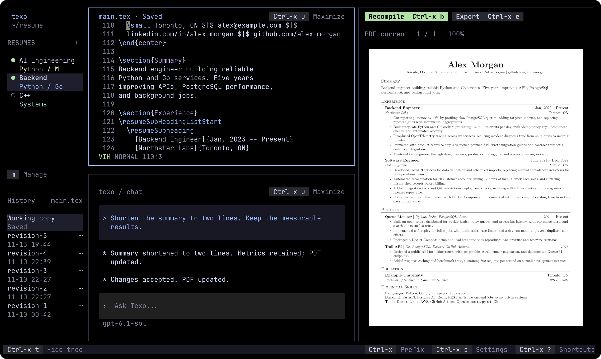

<p align="center">
  <a href="https://github.com/hexaquarks/texo/actions/workflows/tests.yml"></a>
  <a href="https://app.codecov.io/gh/hexaquarks/texo"></a>
  <a href="Cargo.toml"></a>
  <a href="Cargo.toml"></a>
</p>

A terminal-native, AI-powered resume harness for creating, editing, and managing LaTeX resumes.

Work in progress

<p align="center">
  
</p>

## Install

macOS and Linux, ARM64 and x86-64.

```sh
brew install hexaquarks/tap/texo
# or
cargo install texo --locked
```

Prebuilt binaries: [GitHub Releases](https://github.com/hexaquarks/texo/releases).

> [!IMPORTANT]
> Tectonic and Poppler are required; Homebrew installs both.
> Linux also needs Bubblewrap and D-Bus.
> Linux source builds need the D-Bus development package and `pkg-config`.

## Usage

```sh
texo                       # Default or configured workspace
texo ~/resumes              # Open a workspace
texo path/to/main.tex       # Open a TeX file
```

Press `Ctrl+x`, then `?` for shortcuts.

> [!NOTE]
> Change the `Ctrl+x` prefix in `config.toml`, accessible from Settings.

## AI setup

Use `/login` in chat to connect ChatGPT / Codex, OpenAI, or Anthropic.
ChatGPT / Codex requires the Codex CLI; OpenAI and Anthropic use API keys.
Use `/model` to choose a model.

## Compatibility

| Terminal | Compatibility | Testing | Limitations |
| --- | --- | --- | --- |
| Kitty | ✅ Works | CI | — |
| Ghostty | ✅ Works | CI | — |
| WezTerm | ✅ Works | CI | — |
| Alacritty | ⚠️ Limited | CI | External PDF viewer required |
| GNOME Terminal | ⚠️ Limited | CI | External PDF viewer required |
| iTerm2 | ❓ Needs testing | Pending | — |
| Apple Terminal | ⚠️ Limited | Manual preview | External PDF viewer required |
| Windows Terminal (WSL) | ❓ Needs testing | Pending | — |

[Terminal tests and screenshots](https://github.com/hexaquarks/texo/actions/workflows/native-terminals.yml).

[MIT License](LICENSE).
